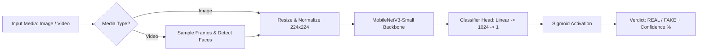

<div align="center">

# 🛡️ DeepFake Detection System with MobileNetV3

**An end-to-end, high-performance Deepfake Image & Video Detection Pipeline in PyTorch**

[](https://www.python.org/)
[](https://pytorch.org/)
[](https://pytorch.org/)
[](https://flask.palletsprojects.com/)
[]()
[]()
[]()
[](LICENSE)

[Overview](#-overview) • [Key Features](#-key-features) • [Performance](#-performance-benchmarks) • [Installation](#-installation--setup) • [Usage](#-how-to-run) • [API](#-api-endpoints) • [Directory Structure](#-repository-structure)

</div>

---

## 📌 Overview

This project provides a robust, lightweight, and deployable deepfake detection solution. Built on top of **MobileNetV3-Small** via transfer learning, it accurately distinguishes authentic human facial media from manipulated or AI-generated deepfakes.

The repository includes:
1. **Trained Neural Network**: Fine-tuned PyTorch model (`deepfake_mobilenet_20251110_162136.pth`, 5.93 MB) achieving **85.04% Test Accuracy** and **0.9300 ROC-AUC**.
2. **Interactive Web Application**: A full-stack Flask application supporting real-time video and image uploads with instant visual verdicts and confidence metrics.
3. **Command-Line Interface (CLI)**: Fast standalone inference scripts for single files, folders, or full videos.
4. **End-to-End Notebooks**: Complete Google Colab / Jupyter notebook documenting the entire 20-epoch training and validation pipeline on 140,000+ facial images.
5. **Preprocessing & Mobile Tools**: Video frame extraction, face alignment, and TorchScript optimization for mobile deployment.

---

## ✨ Key Features

- **High Precision & Lightweight**: MobileNetV3-Small backbone offers fast CPU and GPU inference with a tiny 5.93 MB footprint.
- **Multimodal Support**: Seamlessly analyzes both **static images** (`.jpg`, `.png`, `.webp`) and **video streams** (`.mp4`, `.avi`, `.mov`).
- **Frame-by-Frame Video Processing**: Automatically samples video frames, detects facial bounding boxes with Haar Cascade, and produces an aggregated confidence score.
- **Ready-to-Use Web Portal**: Beautiful UI with animated progress loader, visual verdict badges (REAL / FAKE), and detailed probability breakdowns.
- **Production-Ready API**: Clean RESTful `/predict` and `/health` endpoints for easy integration with frontend apps or microservices.

---

## 📊 Performance Benchmarks

The model was trained on over **140,000 facial images** for 20 epochs using the Adam optimizer with Binary Cross-Entropy with Logits loss (`BCEWithLogitsLoss`).

| Metric | Score | Description |
| :--- | :--- | :--- |
| **Test Accuracy** | **85.04%** | Evaluated on 10,905 unseen test images |
| **ROC AUC** | **0.9300** | Area under the Receiver Operating Characteristic curve |
| **PR AUC** | **0.9269** | Area under the Precision-Recall curve |
| **Validation Accuracy** | **81.56%** | Evaluated on 39,428 validation images |
| **Model Footprint** | **5.93 MB** | 244 parameter tensors (MobileNetV3-Small) |

Evaluation plots (Confusion Matrix, ROC Curve, and PR Curve) are included under [`notebooks/evaluation_plots/`](notebooks/evaluation_plots/).

---

## 🏗️ Architecture Pipeline



---

## 🚀 Installation & Setup

### 1. Clone the Repository
```bash
git clone https://github.com/Aarav-Shah-175/Deepfake-Detection.git
cd Deepfake-Detection
```

### 2. Create a Virtual Environment (Recommended)
```bash
# On Windows
python -m venv venv
.\venv\Scripts\activate

# On Linux / macOS
python3 -m venv venv
source venv/bin/activate
```

### 3. Install Dependencies
```bash
pip install -r requirements.txt
```

---

## 💻 How to Run

### Option 1: Interactive Web Portal (Recommended)

Start the local Flask server:
```bash
python app/server.py
```

- Open your browser at **`http://localhost:5000`**
- Go to the **Detection** page (`http://localhost:5000/detection.html`).
- Drag and drop or choose any sample image or video from `samples/`.
- Click **"Analyze File"** to inspect the real-time classification.

---

### Option 2: Command-Line Interface (CLI)

The CLI tool allows fast testing without running a web server:

#### Single Image Prediction:
```bash
python cli/predict.py --image samples/fake_365.jpg
```
```text
============================================================
      Deepfake MobileNet Detection Engine
============================================================
[*] Loaded model on device: CPU
[*] Processing image: samples/fake_365.jpg
--------------------------------------------------
  Result     : Fake
  Confidence : 63.26%
  Prob(Real) : 0.3674
  Prob(Fake) : 0.6326
  Raw Logit  : -0.5436
--------------------------------------------------
```

#### Batch Directory Prediction:
```bash
python cli/predict.py --dir samples
```
```text
-----------------------------------------------------------------
Filename                       | Prediction | Confidence | Prob(Real)
-----------------------------------------------------------------
fake_331.jpg                   | Real       |  50.60%    | 0.5060
fake_365.jpg                   | Fake       |  63.26%    | 0.3674
fake_7.jpg                     | Fake       |  55.36%    | 0.4464
real_11.jpg                    | Real       |  50.58%    | 0.5058
-----------------------------------------------------------------
```

#### Video Analysis:
```bash
python cli/predict.py --video samples/test_videos/Fac123.mp4
```
```text
[*] Analyzing video: Fac123.mp4 (322 frames, 25.0 FPS)
==================================================
  Video          : Fac123.mp4
  Final Decision : FAKE
  Confidence     : 65.26%
  Frames Analyzed: 16 (Fake: 16, Real: 0)
  Avg Prob(Fake) : 0.6526
==================================================
```

---

### Option 3: Jupyter / Colab Training Notebook

To review training procedures, loss curves, and evaluation steps:
```bash
jupyter notebook notebooks/Deepfake_Final.ipynb
```

---

## 🔌 API Endpoints

The Flask server exposes REST endpoints:

### `GET /health`
Returns system health, hardware acceleration device (`cuda` or `cpu`), and model metadata.
```json
{
  "auc_score": "0.9300",
  "device": "cpu",
  "model": "MobileNetV3-Small (Binary Classification)",
  "service": "DeepFake MobileNet Detection Engine",
  "status": "healthy",
  "test_accuracy": "85.04%"
}
```

### `POST /predict`
Accepts `multipart/form-data` with key `file` or `video` containing an image or video file.
```json
{
  "confidence": "65.26%",
  "confidence_value": 65.26,
  "frames_analyzed": 16,
  "fake_frames": 16,
  "real_frames": 0,
  "prediction_label": "Fake",
  "prob_fake": 0.6526,
  "prob_real": 0.3474,
  "success": true,
  "type": "video"
}
```

---

## 📁 Repository Structure

```
├── README.md                      # GitHub documentation & quickstart
├── PROJECT_REPORT.md              # In-depth architectural & integration report
├── LICENSE                        # MIT License
├── requirements.txt               # Validated Python requirements
├── .gitignore                     # Git ignore rules for Python, Flask & PyTorch
│
├── model/                         # Core Machine Learning Models
│   ├── architecture.py            # Model definition & inference helper functions
│   ├── deepfake_mobilenet_20251110_162136.pth   # Final trained weights (85.04% Acc)
│   └── deepfake_mobilenet_acc_73.71.pth         # Secondary reference checkpoint
│
├── app/                           # Flask Web Application
│   ├── server.py                  # HTTP server & API endpoints
│   ├── inference.py               # Singleton PyTorch inference worker
│   ├── static/                    # CSS stylesheets, branding & graphics
│   │   ├── style.css
│   │   ├── face.jpg
│   │   ├── main.png
│   │   └── detection.png
│   ├── templates/                 # Web templates
│   │   ├── index.html             # Landing page
│   │   ├── detection.html         # Media upload and detection portal
│   │   └── about.html             # Documentation & metrics page
│   └── storage/                   # Runtime upload buffer (.gitkeep)
│
├── cli/                           # Command-Line Tools
│   ├── predict.py                 # Multi-format CLI predictor (image/video/dir)
│   ├── extract_frames.py          # Video frame extraction utility
│   ├── preprocess.py              # MTCNN face cropping utility
│   └── export_mobile.py           # TorchScript / Mobile export script
│
├── notebooks/                     # Training Notebooks & Research Artifacts
│   ├── Deepfake_Final.ipynb       # Definitive Colab / Jupyter training notebook
│   ├── Deepfake_Final.ipynb - Colab.pdf # Complete PDF execution document
│   ├── Deepfake_Final.md          # Markdown export with complete training logs
│   └── evaluation_plots/          # ROC, PR, and Confusion Matrix charts
│       ├── output_9_0.png
│       ├── output_11_0.png
│       └── output_12_0.png
│
├── samples/                       # Test Assets (Immediately runnable)
│   ├── fake_331.jpg
│   ├── fake_365.jpg
│   ├── fake_7.jpg
│   ├── real_11.jpg
│   └── test_videos/
│       ├── 11.mp4                 # Sample fake video
│       ├── Fac123.mp4             # Sample fake video
│       └── WhatsApp_Video_Demo.mp4# Sample demonstration video
│
└── Dataset/                       # Local training/testing dataset (33,000+ images)
```

---

## 📜 License

This project is open-source under the [MIT License](LICENSE).
